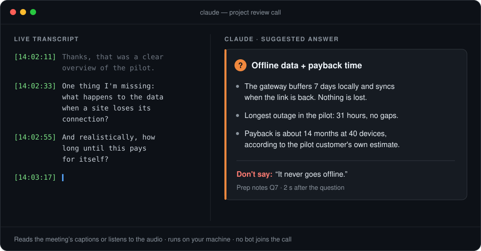
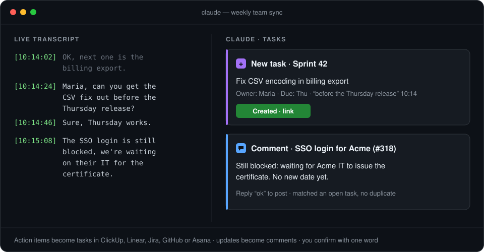
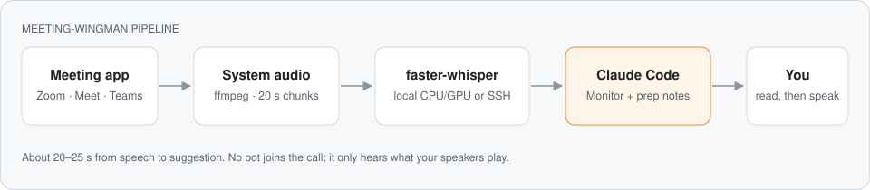

# meeting-wingman

**A live wingman for your Meet, Teams and Zoom calls, inside Claude Code. It tells you what to say when the hard question comes, and turns what your team agrees on into tasks while the meeting is still running.**

[](LICENSE)
[](#install)
[](#works-with-meet-teams-and-zoom)
[-0891b2?style=flat-square)](#requirements)
[](https://github.com/cem-ayyildiz/meeting-wingman/actions/workflows/ci.yml)
[](https://github.com/cem-ayyildiz/meeting-wingman/stargazers)

<p align="center">
  
</p>

**Coach mode.** You are on a client call. Someone asks the question you were hoping to avoid.
meeting-wingman has been following the call since it started. Two seconds after they stop talking, a card
with three bullets appears: what to say, with your own numbers from your prep notes, and one thing
**not** to say.

**Team mode.** In your weekly sync, Maria says she will fix the CSV export by Thursday. A task
appears in ClickUp (or Linear, Jira, GitHub, Asana) with her as owner. Someone mentions the SSO
login is still blocked, and that becomes a comment on the existing task instead of a duplicate.
You confirm each one with a word, or let it write on its own.

No bot joins the call. It either reads the meeting's own captions in your browser (with speaker
names) or listens to your computer's audio and transcribes it, on a GPU when one is free and on
the CPU otherwise. It can translate every line into your language as it goes, and it only wakes
Claude for what matters: questions, your name, commitments, decisions, numbers.

```
/plugin marketplace add cem-ayyildiz/meeting-wingman
/plugin install meeting-wingman@meeting-wingman
```

Then tell Claude: *"I'm joining a client call in ten minutes. Listen and help me with the questions."*
or *"Listen to our standup and put the action items into ClickUp."*

---

## Examples

Say it in your own words; these are the kinds of requests the skill is built for.

1. *"I have an investor call on Zoom in 15 minutes. Read `notes/q3-numbers.md`, then listen and
   help me answer their questions."* Claude reads the notes, starts the transcription, and from
   then on answers every question with a short card.
2. *"Listen to our weekly sync on Teams and put the action items into the Sprint 42 list in
   ClickUp. Ask me before you create anything."* Claude loads the list, its members and open
   tasks, and proposes each task or comment for a one-word "ok".
3. *"This Meet call is in Japanese. Transcribe it and give me an English translation of every
   line."* Claude starts with `-l ja -x en` and the English line appears under each Japanese one.
4. *"The meeting is over. Save the transcript to `meetings/` and list what we promised to send."*

## Coach mode

For meetings where you have to answer: clients, interviews, reviews, investors. A local filter
watches the transcript and wakes Claude only for questions, your name and numbers; the rest
reaches it as a digest every few minutes, so the screen stays quiet until something needs you.
Each reply is short, because you are reading while you talk.

| When | Claude writes |
|---|---|
| Small talk, presentation, no question | Nothing (it arrives later in a digest) |
| Someone asks you something | **❓ The question in a few words**, then 2–3 bullets you can say as they are, with numbers. If there is a trap, one `Don't say:` line |
| Someone on your side says a wrong number, a wrong date or an overclaim | One line with the correct version |
| The meeting reaches a part you present | A 2–3 bullet reminder |

Before the meeting it helps you prepare: a term list so names and acronyms come out right, and,
if you want one, a prep document with likely questions and 60-second answers
([template](skills/meeting-wingman/templates/prep-notes.md)). Afterwards it saves the transcript,
summarises which answers were weak, and lists what you promised to send.

## Team mode

<p align="center">
  
</p>

For internal meetings: standups, planning, project syncs. Before the meeting Claude loads the
list or project from your tracker, its members and its open tasks. During the meeting:

| Heard | Claude does |
|---|---|
| "Maria, can you get the CSV fix out before Thursday?" | **New task**, owner Maria, due Thursday |
| "SSO is still blocked, we're waiting on their IT" | **Comment** on the open SSO task, not a duplicate |
| "OK, we go with option B" | **Comment** with the decision on the related task |
| A problem nobody picks up | **New task**, unassigned, flagged |

You choose how much it writes on its own: `confirm` (default, you answer "ok"), `auto` (writes
at once and shows the link) or `end` (collects everything and writes after you review the list).
It assigns only people who are in the workspace, follows the workspace's language and
conventions, and never pastes the transcript into a task.

Any tracker Claude Code can reach works: an MCP server (ClickUp, Linear, Jira, Asana, Notion) or a
CLI (`gh` for GitHub Issues). Without one, the items go to a file.

## Works with Meet, Teams and Zoom

Two sources, pick per meeting:

| | **Captions** (`--captions`) | **Audio** (default) |
|---|---|---|
| Works with | Meet, Teams and Zoom **in the browser** (Chrome, Edge, Chromium), captions turned on | Any app that makes sound: Meet, Teams, Zoom desktop or browser, Webex, Slack huddles, Discord |
| Speaker names | Yes, from the meeting | No |
| Needs | Remote debugging on once (`chrome://inspect/#remote-debugging`); the browser asks you to allow it | `ffmpeg` and faster-whisper; a GPU helps |
| Latency | About 2 s after a caption settles | 1–3 s after the speaker pauses |
| Languages | Those the platform captions | Whisper's ~100 |

Captions are best for team meetings, where it matters who said "I'll take it". Audio works
everywhere, including the desktop apps. Nothing is installed in the meeting and no bot joins it.

Google Meet captions are tested against the real page structure; the Teams and Zoom web readers
are new and [need reports](https://github.com/cem-ayyildiz/meeting-wingman/issues) from real meetings.
If a platform changes its page, `WINGMAN_CAPTION_BLOCK`, `WINGMAN_CAPTION_SPEAKER` and
`WINGMAN_CAPTION_TEXT` take CSS selectors without waiting for a release.

## Translation

Add `-x <language>` and every line gets a translation underneath, from a local
[NLLB-200](https://huggingface.co/facebook/nllb-200-distilled-600M) model through CTranslate2
(the same engine faster-whisper uses, so nothing new to install):

```
[13:05:51] Pilot sahada üç ay sorunsuz çalıştı, şimdi ikinci aşamayı planlıyoruz.
[13:05:51] ↳ en: The pilot's been in the field for three months, and we're planning a second phase.
```

The meeting can be in any of Whisper's ~100 languages and the translation in any of NLLB's 200.
A sentence takes about 0.3–0.4 s on a laptop CPU. The model is downloaded on first use: 0.6 GB
(600M, CPU) or 1.4 GB (1.3B, GPU). NLLB-200 is licensed **CC-BY-NC-4.0** (non-commercial); set
`WINGMAN_TRANSLATE_MODEL` to another CTranslate2 NLLB-compatible model if that does not fit.

## How it works

<p align="center">
  
</p>

1. **Captions source:** a small DevTools client reads the caption blocks of the Meet, Teams or Zoom
   tab once a second and writes each settled caption as `[time] Speaker: text`.
   **Audio source:** `ffmpeg` records the system audio and your microphone; a voice-activity
   segmenter cuts at pauses, so silence is never transcribed;
   [faster-whisper](https://github.com/SYSTRAN/faster-whisper) turns each utterance into a line
   (`large-v3` on a GPU, `small` on a CPU, locally or on another machine over SSH, falling back to
   the CPU when the GPU is missing, busy or out of memory).
2. Optionally a local NLLB model adds a translated line under each line.
3. `wingman watch`, a local filter, sends Claude Code an event only for lines that match the mode
   (questions, your name, numbers in coach mode; commitments, decisions, blockers, dates in team
   mode), with the quiet lines before it as context, and a digest of the rest every few minutes.
4. Claude replies: answer cards in coach mode, tasks and comments in team mode.

**Recommended setup:** run Claude Code in **VS Code** (or another editor with the Claude Code
panel) beside the meeting window, so the cards are next to the call. Join from the computer as you
normally do; with the audio source your microphone is recorded too. If you speak from another
device (a phone dialled into the meeting), add `--no-mic`.

## Install

**Claude Code (recommended):**

```
/plugin marketplace add cem-ayyildiz/meeting-wingman
/plugin install meeting-wingman@meeting-wingman
```

<details>
<summary><strong>From the terminal, or without the plugin system</strong></summary>

```bash
claude plugin marketplace add cem-ayyildiz/meeting-wingman
claude plugin install meeting-wingman@meeting-wingman
```

Or copy the skill by hand:

```bash
git clone https://github.com/cem-ayyildiz/meeting-wingman
cp -r meeting-wingman/skills/meeting-wingman ~/.claude/skills/
```

</details>

**Updates:** Claude Code does not update third-party plugins automatically by default. Run
`/plugin`, open **Marketplaces**, select **meeting-wingman** and turn on auto-update, or run
`/plugin marketplace update meeting-wingman`.

**Claude Code only.** The plugin records audio and runs local programs, and it needs Claude
Code's Monitor tool to receive transcript lines while you talk, so it does not work in claude.ai
chat or Cowork. Inside Claude Code the plugin also puts a `wingman` command on the PATH.

## Requirements

| | Linux | macOS (beta) |
|---|---|---|
| Audio capture | PulseAudio or PipeWire (`pipewire-pulse`), works out of the box | A loopback device such as [BlackHole](https://github.com/ExistentialAudio/BlackHole) plus a Multi-Output Device (speakers + BlackHole) |
| Tools | `ffmpeg`, `bash`, Python 3.9+ | `ffmpeg`, `bash`, Python 3.9+ |
| Transcription (audio source) | `pip install faster-whisper` | `pip install faster-whisper` |
| Captions source | Chrome, Edge or Chromium; nothing to install | the same |

Windows is not supported yet. Run `wingman doctor` once: it checks each of these and says what is missing.

A CPU is enough: the `small` model keeps up in real time with lower accuracy. With an NVIDIA GPU
you get `large-v3` (about 4 GB of GPU memory), which handles names and mixed languages much
better. When the GPU cannot be used at start-up, both transcription and translation load on the
CPU instead and `wingman start` tells you so. If the GPU is on another machine, see [Remote GPU](#remote-gpu).

## Configuration

Nothing is required. To change the defaults, put `KEY=value` lines in
`~/.config/meeting-wingman/config`.

<details>
<summary><strong>All settings</strong></summary>

| Variable | Default | |
|---|---|---|
| `WINGMAN_REMOTE_HOST` | (none) | SSH host that runs the transcription |
| `WINGMAN_REMOTE_PYTHON` | `python3` | Python with faster-whisper on that host |
| `WINGMAN_REMOTE_DIR` | `.meeting-wingman` | Working directory on that host, relative to home |
| `WINGMAN_PYTHON` | `python3` | Local Python with faster-whisper |
| `WINGMAN_MODEL` | `large-v3` on GPU, `small` on CPU | Any faster-whisper model, e.g. `large-v3-turbo`, `medium`. With a remote host it applies to the host; the local fallback picks by device |
| `WINGMAN_DEVICE` | `auto` | `cuda` or `cpu`. `auto` tries the GPU and falls back to the CPU |
| `WINGMAN_TRANSLATE_MODEL` | 1.3B on GPU, 600M on CPU | CTranslate2 NLLB model for `-x` (Hugging Face repo or local path) |
| `WINGMAN_TRANSLATE_DEVICE` | `auto` | Same as `WINGMAN_DEVICE`, for the translator |
| `WINGMAN_PAUSE` | `0.7` | Pause in seconds that ends an utterance |
| `WINGMAN_MAX_CHUNK` | `15` | Longest utterance before a forced cut |
| `WINGMAN_AUDIO_SOURCE` | Linux `@DEFAULT_MONITOR@`, macOS `BlackHole 2ch` | System audio to capture |
| `WINGMAN_MIC` | `auto` | `auto` (the default microphone), `none`, or a source name. A Bluetooth headset switches to headset mode when its microphone opens; in a call the app already does this |
| `WINGMAN_DIGEST` | `300` | Seconds between digests of lines that woke nobody |
| `WINGMAN_NAMES` | (none) | Your name(s), so "Ana, what do you think?" wakes Claude (same as `-n`) |
| `WINGMAN_CDP` | `main` | Browser for `--captions`: `main` (your own, via its DevToolsActivePort) or a debugging port |

</details>

### Remote GPU

```
WINGMAN_REMOTE_HOST=gpu-box
WINGMAN_REMOTE_PYTHON=~/venvs/whisper/bin/python
```

The host needs Python with faster-whisper. This machine needs `rsync` and an SSH key that works
without a prompt. If SSH fails or the model does not load on the host (for example, the GPU is out
of memory), `wingman start` says so and falls back to local transcription within seconds, so the
meeting is never left without a transcript.

## The `wingman` command

Claude runs it for you. You can also run it yourself
([`skills/meeting-wingman/scripts/wingman`](skills/meeting-wingman/scripts/wingman)):

```bash
wingman doctor                                          # check the setup once
wingman start -m coach -n Ana -l en -t "Acme, SOC 2"   # audio, wake on questions, your name, numbers
wingman start -m team -n Ana --captions                 # captions from the browser tab
wingman start -l ja -x en                               # Japanese call, English under each line
wingman watch                                           # events for Claude (--raw: every line)
wingman show 60                                         # the last 60 lines
wingman level                                           # system audio and microphone levels
wingman stop notes/client-call-transcript.txt           # stop and save, keep no other copy
wingman status
```

State lives in `~/.local/state/meeting-wingman/`.

## Limits

- **A second or two behind,** plus the time Claude takes to write the card.
- **No speaker labels with the audio source.** Use captions when names matter.
- **The filter is keyword-based.** It catches most questions and commitments in English, Turkish,
  German, French, Spanish, Italian, Dutch and Portuguese; the digest covers what it misses.
- **Names and acronyms come out garbled** without a term list, and sometimes with one. Claude reads for meaning.
- **Translation is literal**, sentence by sentence, and weaker on the CPU model. Claude reads the
  original for meaning and numbers.
- **It only hears the computer.** If you are in the room with the other person, this is the wrong tool.

## What it runs, sends and fetches

Everything the plugin does is in readable bash and Python in
[`skills/meeting-wingman/scripts/`](skills/meeting-wingman/scripts/):

| | |
|---|---|
| **Runs** | `ffmpeg` to record the system audio and microphone, `python3` with faster-whisper (and CTranslate2 for translation) to transcribe, `rsync` and `ssh` only in remote mode. With `--captions`: a DevTools connection to your own browser on `127.0.0.1`, which lists the open tabs to find the meeting and then reads only the caption text of that tab |
| **Sends** | Audio chunks only to the SSH host you configure in `WINGMAN_REMOTE_HOST`, and only if you configure one. Tasks and comments only to the tracker you connected yourself, in team mode, with your confirmation unless you chose `auto`. Transcript lines are read by Claude Code like any other text in your session |
| **Fetches** | The faster-whisper speech model and, with `-x`, the NLLB-200 translation model, from the Hugging Face Hub on first use |
| **Keeps** | Audio chunks for a few seconds, until they are transcribed. The transcript only at the path you give `wingman stop`; no copy is left in the state folder or on the remote host |

No analytics, no telemetry, no server run by the author. Details in [PRIVACY.md](PRIVACY.md).

## Consent and privacy

This tool transcribes other people. In many places you must tell the other participants, or get
their consent, before you do that, and company policies may forbid it. The skill reminds you at the
start; using it lawfully is your responsibility.

Audio and transcripts stay on your machine or your own SSH host. Transcript lines are read by
Claude Code, so they go to the model provider like everything else in your session. See
[PRIVACY.md](PRIVACY.md) for the full policy and [SECURITY.md](SECURITY.md) to report a vulnerability.

## Troubleshooting

<details>
<summary><strong>No line ever arrives</strong></summary>

Run `wingman level`. Around −60 dB or lower means nothing is playing: the computer is not in the
meeting, the app or tab is muted, or the default output device is wrong (Linux: `wpctl status`).
</details>

<details>
<summary><strong>The transcript contains sentences nobody said</strong></summary>

Whisper invents text during silence ("Thank you for watching", subtitle credits, or the hint list
read back). The common ones are filtered. Add the ones in your language to `HALLUCINATIONS` in
[`transcribe_server.py`](skills/meeting-wingman/scripts/transcribe_server.py), and please send a PR.
</details>

<details>
<summary><strong>Lines stop arriving in remote mode</strong></summary>

`ssh <host> 'ls .meeting-wingman/in; tail .meeting-wingman/server.log'`. If chunks pile up, the
server has died: `wingman stop`, then `wingman start` again.
</details>

## Contributing

Issues and PRs are welcome, especially macOS testing, Windows capture, and hallucination filters
for more languages. See [CONTRIBUTING.md](CONTRIBUTING.md).

## License

[MIT](LICENSE)
